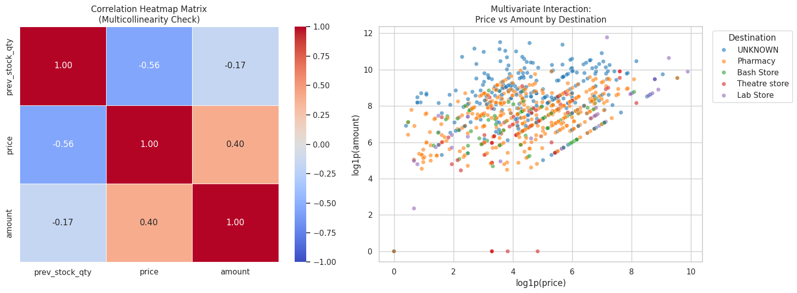
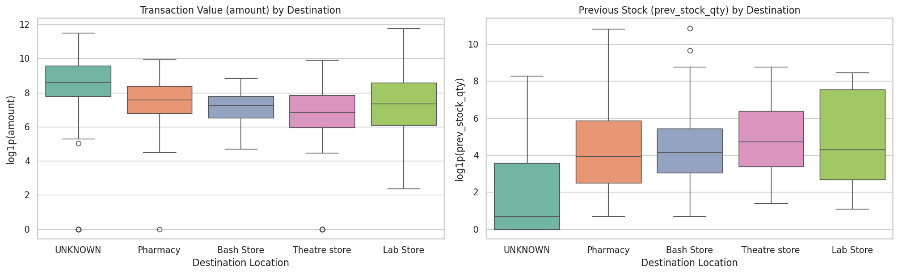
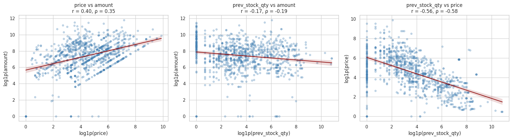

# Pharmaceutical Inventory & Stock Movement Analysis

[](https://www.python.org/)
[](https://pandas.pydata.org/)
[](https://numpy.org/)
[](https://scipy.org/)
[](https://seaborn.pydata.org/)

---

## Executive Summary

Hospital pharmacies move clinical supplies under two very different patterns: everyday ward dispensations occur in small, routine amounts, while centralized vendor replenishments arrive in bulk batches of tens of thousands of units. When recorded in transactional ledger software, this structural variance introduces severe statistical skewness, unindexed database retry duplicates, and systemic missing values.

This repository documents the end-to-end data audit, type correction, business-informed imputation, and statistical validation of 1,000 raw ledger records tracking clinical pharmaceuticals (including Prednisolone, Fuclear V Pessaries, and Isocet P). By replacing blunt row deletions with transaction-direction classification and stabilizing feature variance with logarithmic transformations, the raw extract was converted into an analytically verified dataset without flattening legitimate bulk intake scale. Formal hypothesis tests confirm statistically significant capital disparities across facility destinations and prove that the dispensary operates under disciplined, lean inventory control for high-cost products.

---

## The Business Problem & Objectives

A clinical supply chain balances two operational risks: running out of essential medicines or locking up liquid operating capital in slow-moving pharmaceutical stock. In this facility, administrative oversight was compromised by four core record-keeping challenges:

Internal transfers from central holding to clinics were logged without vendor invoice identifiers. Standard data cleaning scripts treat these routine transfers as missing data errors unless separated by movement direction.

High-value vendor deliveries frequently entered the system without invoice tokens or receiving clinic tags, creating reconciliation blind spots for central intake batches.

Manual stock adjustments lacked visibility into individual scale and personnel attribution, making it difficult to distinguish legitimate batch reconciliation from spoilage, breakage, or physical shrinkage.

Massive volume differences between routine dispensary issues and wholesale intake skewed arithmetic averages, making raw metrics misleading for stocking decisions.

The goal of this analysis was to build a reproducible pipeline to rectify data type defects, audit adjustments, account for missing transfer documentation, and evaluate the monetary dynamics governing movement between the Main Store, the Pharmacy, and specialized wards.

---

## Repository Layout

```text
pharmaceutical-inventory-analysis/
├── Data/
│   ├── inventory_raw.xlsx              # Original unedited Excel export (1,000 records)
│   └── inventory_clean.csv             # Processed, imputed, and scaled production dataset
├── notebooks/
│   └── pharmaceutical_inventory_analysis.ipynb
├── images/
│   ├── univariate_distributions.png
│   ├── correlation_heatmap.png
│   ├── destination_boxplots.png
│   └── price_amount_scatter.png
├── .gitignore
├── requirements.txt
└── README.md

## Data Dictionary & Audit Baseline

The archival ledger consists of 1,000 raw transaction events captured across 16 initial fields:

- `item_code`: Unique catalog identifier assigned to each pharmaceutical line item (1,000 non-null).
- `item_name`: Active chemical formulation, dosage strength, and brand packaging (1,000 non-null).
- `date`: Transaction timestamp string requiring datetime conversion (1,000 non-null).
- `reference`: Unique journal voucher, batch receipt, or store issue number (1,000 non-null).
- `description`: Operational journal summary of the event (995 non-null, 0.5% missing).
- `client`: External billing account code (5 non-null, 99.5% missing).
- `quantity`: Physical units moved or adjusted, stored as an unparsed string where positive values represent intake and negative values denote dispensations (1,000 non-null).
- `movement_type`: High-level event category such as stock entries or manual stock adjustments (1,000 non-null).
- `purpose`: Operational business justification, including ward transfers and inventory balancing (1,000 non-null).
- `source_location`: Originating facility or storeroom (999 non-null, 0.1% missing).
- `destination_location`: Receiving ward or clinical unit (736 non-null, 26.4% missing).
- `created_by`: System username of the staff member logging the transaction (1,000 non-null).
- `prev_stock_qty`: Physical on-hand balance immediately prior to movement (982 non-null, 1.8% missing).
- `price`: Unit acquisition cost or standard catalog price (1,000 non-null).
- `amount`: Total transaction financial value calculated as unit price multiplied by movement quantity (996 non-null, 0.4% missing).
- `stock_invoice`: External commercial invoice string (228 non-null, 77.2% missing).

---

## Data Cleaning & Engineering Decisions

Standard cleaning methods like dropping records with missing cells or trimming extreme values destroy valid supply chain history. The cleaning pipeline used domain logic aligned with hospital workflows.

The `client` column was blank across 99.5% of rows, serving as an unpopulated billing artifact on internal ledger entries. It was dropped to reduce dimensionality noise.

The raw `quantity` field was stored as an unformatted string. It was stripped of whitespace and parsed into a signed numeric float so positive additions and negative deductions could be computed mathematically.

System lag and duplicate keystrokes wrote identical transaction events under separate timestamps. Screening across physical transaction footprints—date, item code, quantity, and amount—isolated and removed 18 operational duplicate rows while retaining the initial posting.

Missing invoice entries were resolved through movement sign verification. Internal stock issues to wards do not generate commercial supplier bills. Outbound movements (`quantity <= 0`) missing invoices were categorized as `DISPATCH_LOG` (74.54% of records)[cite: 2]. Undocumented positive receipts (`quantity > 0`) were isolated as `MISSING_RECEIPT_ID` (1.73%) for physical intake compliance audits[cite: 2].

The single missing origin in `source_location` was imputed to `Main Store`, reflecting the 99.59% concentration of historical disbursements[cite: 2]. Unassigned entries in `destination_location` (26.4% of the raw data) were mapped to `UNKNOWN` rather than assigned to a clinic, preventing high-value central intake batches from inflating ward metrics.

Missing continuous entries in previous stock, quantity, and amount were imputed using the median of each specific item code group. Imputing by SKU cluster prevents high-volume consumables from skewing low-volume, high-cost specialty medications.

Outlier screening flagged extreme values in previous stock, unit price, and transaction amount, including verified replenishment batches reaching 52,000 units and 130,000 in total value[cite: 1]. These were confirmed wholesale intake shipments, not clerical mistakes[cite: 1]. Capping them would have artificially erased the real scale difference between warehouse receiving and departmental dispensing. A log transformation was applied across continuous features, bringing heavy right tails into balanced distributions while preserving zero-stock baselines[cite: 1].

---

## Exploratory Findings

<p align="center">
  
</p>

The raw continuous metrics displayed severe positive skewness and long right tails due to bulk replenishment orders. Applying a log transformation normalized price, baseline stock, and movement amounts, making them suitable for reliable statistical testing and linear comparisons[cite: 1].

<br>

<p align="center">
  
</p>

Pairwise correlation checks confirmed that all feature relationships remain well below 0.85, ruling out severe multicollinearity. The correlation matrix shows a statistically significant inverse relationship between unit price and baseline stock quantity ($r = -0.561, p < 0.001$). This confirms disciplined inventory management: high-cost drugs are stocked in minimal, tightly controlled quantities to limit held-up capital, while low-cost consumables are maintained in large volumes.

<br>

<p align="center">
  
</p>

<p align="center">
  
</p>

Stratified distribution boxplots and scatter plots highlight distinct operating tiers across facilities. Unassigned inbound shipments (`UNKNOWN`) sit in the highest capital band ($\log 1\text{p}(\text{amount}) > 9.0$). In contrast, clinical units like the Pharmacy (which handles 41.24% of all branch issues) and the Theatre store handle regular, lower-value disbursements[cite: 2].

---

## Empirical Hypothesis Testing

Formal statistical tests were conducted at $\alpha = 0.05$ to verify whether observed differences across facility destinations and metric associations were real operational patterns or random chance.

**Transaction Scale Across Destination Facilities**  
A One-Way ANOVA ($F = 30.333, p = 1.28 \times 10^{-23}$) and a Kruskal-Wallis test ($H = 147.376, p = 7.43 \times 10^{-31}$) both rejected the null hypothesis. The monetary scale handled across destinations is significantly different. Unassigned intake batches represent a fundamentally higher capital tier than routine transfers to clinical wards.

**Association Between Unit Price and Total Transaction Amount**  
A Pearson correlation test ($r = 0.402, p = 1.96 \times 10^{-39}$) and a Spearman rank test ($\rho = 0.353, p = 2.98 \times 10^{-30}$) both rejected the null hypothesis of independence. Product unit price is a verified, statistically significant driver of overall transaction cost across ledger movements.

---

## Strategic Recommendations

- Enforce mandatory invoice logging at the central receiving dock to eliminate the 1.73% of inbound receipts currently entering the ledger without vendor documentation[cite: 2].
- Maintain the inverse price-to-quantity stocking strategy, preserving on-demand pull orders for expensive formulations and bulk buffers for high-turnover clinical consumables.
- Focus internal audit workflows on handoffs between the Main Store and the Pharmacy, as this corridor governs 99.59% of dispatches and 41.24% of internal disbursements[cite: 2].

---

## Environment Setup & Reproducibility

```bash
# Clone repository
git clone [https://github.com/your-username/pharmaceutical-inventory-analysis.git](https://github.com/your-username/pharmaceutical-inventory-analysis.git)
cd pharmaceutical-inventory-analysis

# Set up virtual environment
python -m venv venv
source venv/bin/activate  # On Windows: venv\Scripts\activate

# Install dependencies
pip install -r requirements.txt

# Launch pipeline notebook
jupyter notebook notebooks/pharmaceutical_inventory_analysis.ipynb
```